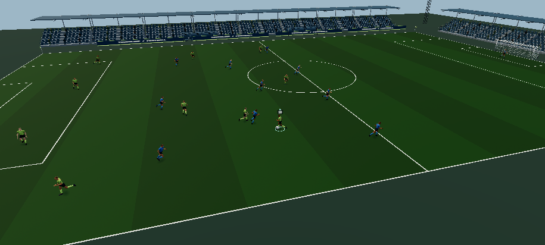
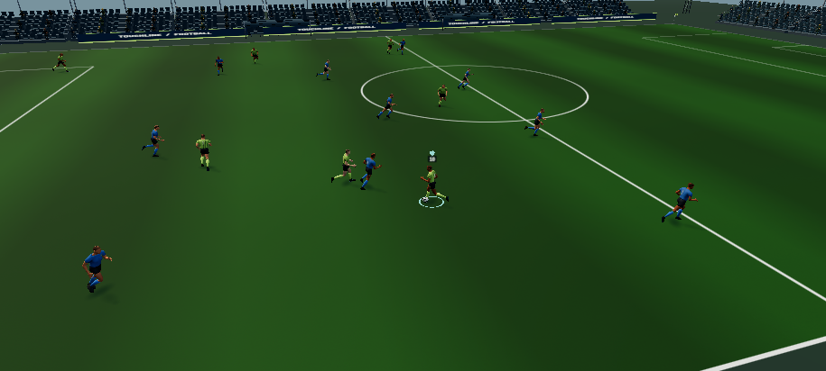

# TEST58 – tættere kamera og mere dybde på banen

Udgangspunkt: TEST57 `ed6d3c03ceae1314e66c61204361c3087bb4da18`.
Branch: `codex/test58-close-broadcast`. Kun R3-præsentation, buildmetadata og tests.
Ingen merge/deployment. Regler, input, boldfysik og optagelsesformat er uændrede.

## Det synlige løft

### Kamera: større spillere og nærmere dueller

R3's broadcast-/pro-kamera bruger 64 % af den tidligere afstand/højde og en
to grader smallere linse. Kameraets vandrette retning bevares præcist; de roterede
styreakser ændres ikke. Den tidligere lineære udvidelse i portræt kunne forøge
afstanden 2,4 gange. En kvadratrodsbaseret tilpasning giver nu plads i højden
uden samme kraftige udzoomning.

Ved en fast 1,8 m figur ved kameraets sigtepunkt giver projektionstesten:

| Visning | TEST57 | TEST58 | Ændring |
| --- | ---: | ---: | ---: |
| 915 × 412 | 24,72 px | 41,22 px | +66,7 % |
| 1280 × 576 | 34,56 px | 57,63 px | +66,7 % |
| 390 × 844 | 20,80 px | 53,77 px | +158,5 % |

Tallene er **beregnet figurhøjde ved sigtepunktet**, ikke en måling af alle
spillere i kampen, fysisk skærmopløsning eller telefon-FPS. Figurer længere væk
vil stadig være mindre. Et tættere udsnit viser en mindre del af banen ad gangen.
Stadion-overblikket er fortsat tilgængeligt via den eksisterende kameravælger.

Den eksisterende dæmpede kameraføring følger bold/spiller uden at dreje styringen.
Luftbolde, større afstand til den valgte spiller og høj fart kan udvide rammen
roligt med højst 8 %. Reduceret bevægelse beholder det tættere statiske udsnit
uden denne dynamiske udvidelse. Afspilning, afspark, baggrund/retur og snap-reset
bevarer deres eksisterende håndtering. Tests kontrollerer boldens indramning
ved sidelinjer, mållinjer og høje bolde i portræt og bredformat.

### Græs, kridt og lys

Tolv flade stribefelter er erstattet af én sammenhængende PBR-græsoverflade med
eksisterende lokale farve-, normal- og roughness-kort. Metrisk UV-tiling bevares
på tværs af hele banen. Kortene klones til deres egen overflade, så bibliotekets
teksturer ikke ændres. Et begrænset statisk gitter tilføjer blødere klippestriber,
små farvevariationer og diskret slid ved midten og begge mål.

Overfladen bruger én tegning i stedet for tolv og omkring 2.880 trekanter ved
60 × 96 m. Der er ingen nye teksturdownloads eller beregning af græs i hvert frame.
Kridtlinjerne er lidt bredere og mere neutrale/hvide. Et analytisk filter
bevarer dækningsgraden for linjer under én pixel, så fjerne linjer ikke
veksler mellem hvide og manglende rasterprøver. Det bruger bredere
dækningsgeometri, men den synlige linje er 15 cm; MSAA forbliver slået
fra i Auto. Midtercirklen bruger samme filter. Lysbalancen giver mindre
fladt fyldlys og tydeligere varmt hovedlys, afbalanceret modlys, mere grøn
farvedybde og et roligere baggrunds-/dybdeudtryk.

### Kontaktskygger og materialer

Fod-, krops-, hoved- og målrammeskygger deler én instansieret tegning. De bløde
skygger forankrer figurerne og giver målrammen synlig højde uden et nyt dynamisk
skygge-map-pass i Auto. Spillerskygger følger den faktisk viste figurposition.
Målrammens statiske skygge projiceres fra den eksisterende hovedlysretning.

Skyggerne er **projicerede tilnærmelser**, ikke præcise skelet-/netskygger.
De små skyggeelementer bruger individuel styrke i samme shader og højst 72
instanser for 22 spillere og to mål. Ingen layoutmåling eller per-bone scanning
tilføjes i render-loopet. Eksisterende 4K-realtidsskygger bevares.

Målrammer får lysere pulverlak med mindre metalpræg; nettet bliver mere læsbart
og gennemsigtigt i én passage. Stadionbeton, stål og marineblå flader får
afstemt roughness/farve. Dragtmaterialets roughness ændres let, så stoffet
fanger lyset tydeligere. Importerede materialer klones; originale GLB/PNG/WAV
og deres SHA-256 forbliver uændrede.

## Samme kamp, før og efter

Kontrollerne nedenfor bruger samme deterministiske R3-state, seed, tick og faste
renderopløsning. De er isolerede billeder fra den faktiske scenekode uden HUD;
den pakkede app kontrolleres særskilt med HUD, indstillinger og navigation.
Software-WebGL bruges til billed-/fejlkontrol, ikke til Android-FPS.

Før, TEST57:

Efter, TEST58:

Portræt og nær-mål-sammenligninger ligger i samme evidensmappe.

## Faste begrænsninger og fysisk prøve

Grundmodellerne, deres skeletter og animationer er de eksisterende. Der er ikke
tilføjet motion matching, tæt geometrisk 3D-græs, global illumination eller nye
fysik-/AI-regler. Kameraføring og materialer kan gøre modellen mere synlig,
men tilfører ikke automatisk flere anatomiske detaljer. Auto tilpasser stadig
renderopløsning og LOD ved belastning; det kan gøre kanter/teksturer blødere.

Simulationen forbliver 20 Hz. Knaprespons, fire-inputsloft, boldfysik,
førsteberøringer, redninger og fuld replay/uploadpakke er bevaret. Visning
ved 60/120 Hz er stadig afhængig af faktisk GPU/CPU-belastning. En fysisk
OnePlus Nord 4 er ikke tilgængelig; installation, vedvarende FPS, varme og
oplevet billedkvalitet er ikke fysisk verificeret.

1. Opdater Touchline TEST uden afinstallation; begynd med Auto/60.
2. Sammenlign spillerstørrelse og dueller med TEST57; prøv broadcast og pro.
3. Følg en stikning og en luftbold. Kameraet skal være tættere uden at dreje
   styrepuden; brug stadion-overblik, hvis du ønsker hele banen.
4. Se på græsstriber, kridt, trøjer, målramme/net og skygger under løb og dyk.
5. Prøv stående/bredformat, fullscreen og baggrund/retur. Eksportér ydelsesrapport
   efter 5–10 minutters spil og mærk efter varme samt vedvarende billedfrekvens.

## Bevarede grænser og filer

APK 37, tidligere APK/PDF, motor 1–10, R1/R2, eksisterende optagelser, test-id/
certifikat, lokale valg, main, produktionsdata og offentlig hjemmeside v56
bevares. Lanceringen er fortsat fredag 1. januar 2027 kl. 10.00 København /
09.00 UTC. Ingen ændring af `shared/`, `worker/`, native Android-kode eller
de binære ressourcer i `public/`.

- R2: `4ad518a8d5fe454a76cbca4345f0f2294a1b6e7fddb3f98c9d17dad47d6d6f42`.
- R3: `274b4d45a4fae126f62e3e9d79f7c76e9bc8eca0aa6d59fcfcc1203961fe1e10`.

Ændrede/oprettede kildefiler:

Slutkontrol på kildecommit `ada5ccc89245aada1157a7dbdd6d5e3ebbaade7b`:
**793 tests, 793 beståede, 0 fejl, 0 skip, 0 annulleret**.
APK: 47.136.397 bytes (47,14 MB), kode 58, `1.0.0-test-broadcast58`.
SHA-256: `18b135ce18fd73e6c4d94e191c6e600384b4c668d3be4d977ee26f8a403d422e`.
Samme TEST-id/certifikat; ZIP/CRC og alle 43 pakkede webfiler er byte-verificeret.

Opstarts-JavaScript: 940.237 bytes mod 940.166 i TEST57. Samlet JS: 1.868.869
mod 1.863.927. Den binære asset-pakke er uændret 46.637.951 bytes. Three.js og
modeller er stadig adskilt fra login/opstart; ingen nye runtimeafhængigheder.

Isoleret Chromium kontrollerer midtbanen på tick 550 og en målsituation på tick
928 før/efter med identiske boldpositioner og renderopløsninger. Pakket app
kontrolleres i Auto/Skarp med lyd, fullscreen/retur og eksport. Ingen registrerede
runtime-/konsolfejl eller eksterne værtskald i disse fixtures. Ingen fysisk
Android-verifikation. Den præcise filfortegnelse ligger i
`test-evidence/broadcast-TEST58-files.json`.

- `src/living-camera.js`, `src/match-lighting.js`, `src/manual-scene.js`.
- `src/broadcast-pitch.js`, `src/broadcast-shadows.js`, `src/broadcast-surfaces.js`, `src/broadcast-chalk.js` (nye).
- `src/pro-player.js`, `src/rich-match-assets.js` (materialer).
- `tests/broadcast-look.test.mjs` (ny), `package.json`, `dev/test-release.json`.
- Denne dokumentation, `TEST-ANDROID.md`, ny TEST58-APK/PDF og `test-evidence/broadcast-TEST58-*`.
